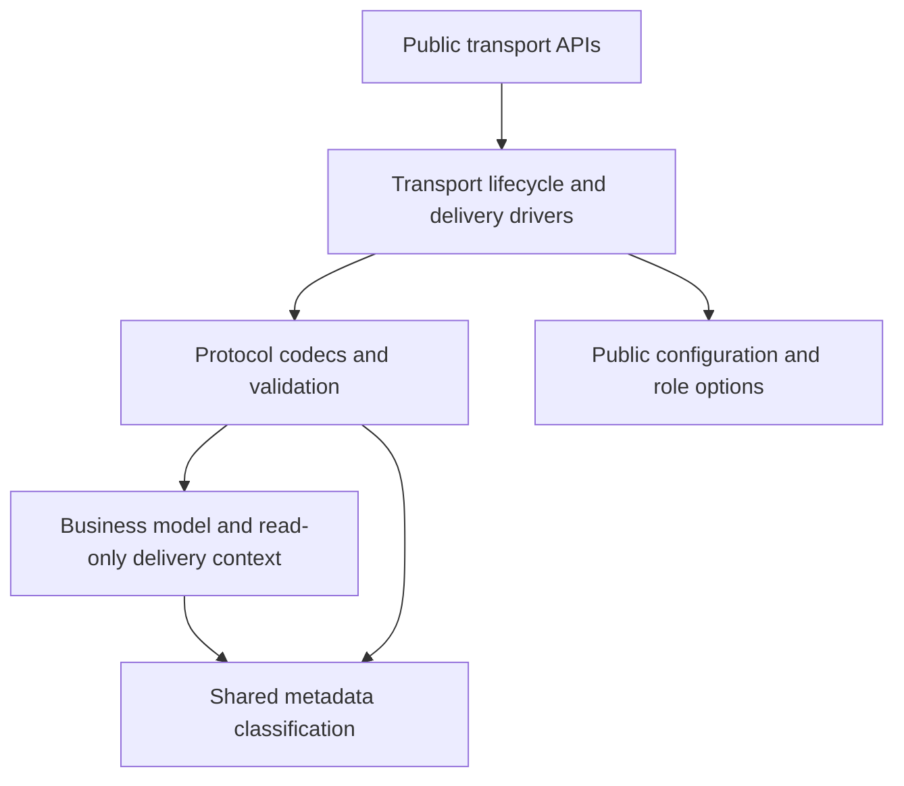

# EventMesh Rust SDK architecture

This document records implementation constraints and protocol boundaries. For public usage, see [README.md](README.md); for build and test commands, see [CONTRIBUTING.md](CONTRIBUTING.md).

## Public API boundaries

- `src/lib.rs` denies unsafe code.
- Consumers and webhook servers invoke the public `MessageHandler` directly with `Message`. Transport-private helpers decode and encode that envelope; there is no separate listener trait or handler adapter with an associated message type.
- Producers use concrete transport methods behind the public `GrpcProducer`, `HttpProducer`, and `TcpProducer` APIs. Message dialect selection remains in the public producer facade, while each transport owns its wire encoding and supported operations. There is no internal `Publisher` or `RequestReply` trait requiring unused or unsupported methods.
- Subscription is intentionally transport-specific. Each consumer owns its receive loop where applicable and exposes lifecycle methods suited to its protocol.
- `src/common/` contains protocol keys, status codes, constants, and the shared `LoadBalanceSelector`.
- `model` owns business data and read-only received context. Producer operations apply `transport/validation.rs` policies before encoding; shared native encoders also serve handler replies and must not apply producer-only content or TTL checks. The model does not depend on gRPC, HTTP, or TCP. `common/metadata.rs` classifies reserved keys for both business-property validation and wire metadata separation.
- Internal transport helpers and re-exports are gated by their consuming features; `common` and `model` have no module-wide unused-code exemptions. The shared Java wire-key and status/request-code catalogs retain documented `dead_code` exemptions on their constant-only implementations.

## Generated protobuf code

`build.rs` uses `tonic-build` to compile `proto/eventmesh-{service,cloudevents}.proto` into Cargo's `OUT_DIR`. It creates client stubs only and enables `--experimental_allow_proto3_optional`. The two `.proto` inputs and the hand-written `src/proto_gen.rs` wrapper are checked in. The generated Rust files remain in `OUT_DIR` and are loaded by `tonic::include_proto!`; under the current build setup, those generated files are not checked in. Add convenience aliases to `proto_gen.rs` rather than editing build output.

## Wire formats

`EventMeshMessage` is a business model, not a shared wire DTO. Each transport owns its serialization:

| Transport | Boundary | Encoding |
| --- | --- | --- |
| gRPC | `src/transport/grpc/codec.rs` | CloudEvents protobuf |
| HTTP | `src/transport/http/codec.rs` | Form URL encoding, with JSON in `content` |
| TCP | `src/transport/tcp/message.rs` | Length-prefixed binary frames with `EventMesh` magic |

Native messages separate business data from delivery context:

- `EventMeshMessage` owns topic, content, business/unique IDs, TTL, content type, and business properties.
- `DeliveryContext` in `src/model/delivery.rs` owns received protocol descriptors and known identity/routing attributes. Its public API is read-only; only SDK decoders can attach it. Credentials are redacted in Debug output.
- `decode_native_message` in `src/transport/metadata.rs` separates wire attributes for every native decoder. The same module owns private extraction and reply-context methods. HTTP form fields take precedence over duplicated IDs in `extFields`. Protocol-specific wire representations remain private.
- Property builders and setters reject reserved names using the shared classification in `src/common/metadata.rs`. Encoders retain the same guard as defense in depth and never serialize a delivery context during normal publish, broadcast, or a new request.
- TCP `RESPONSE_TO_SERVER` encoding restores known reply-routing attributes from the original request context, including Runtime `req0*`/`rsp0*`, cluster, and RocketMQ `correlation99id`/`reply99to99client`. The consumer attaches the original request context even if the handler returns a message received elsewhere. gRPC replies retain routing from their original protobuf request. ACK correlation continues to use the original wire frame.

TTL has one business source: its dedicated field. HTTP/gRPC retain their 4000 ms outbound default; TCP leaves an unset TTL to the Runtime. Content type is also a dedicated field, encoded as a gRPC attribute, TCP message header, or HTTP `extFields` entry. Decoders reject malformed or out-of-i64-range TTL while preserving numeric values until outbound validation. CloudEvents keep their standard attributes/extensions; native-to-CloudEvents reply conversion maps the dedicated fields and reply context explicitly.

Outbound CloudEvent metadata follows the same ownership policy as native messages. A new operation filters known transport/delivery extensions from a copy; destination configuration supplies credentials and identity. Inbound events and business extensions are preserved. A reply takes internal routing from its current request, even if the handler returns a foreign event, while explicit reply business extensions win. gRPC reply tagging preserves content type and data rather than applying Java's unconditional JSON label. These intentional Java compatibility differences are recorded in [MIGRATING_FROM_JAVA.md](MIGRATING_FROM_JAVA.md).

TCP CloudEvents use `protocoltype=cloudevents` and raw `application/cloudevents+json` bytes, matching the Java runtime codec path.

## Configuration

- Every transport consumes the public configuration types directly:
  `GrpcConfig`, `HttpConfig`, and `TcpConfig`, together with the role
  options (`ProducerOptions`, `ConsumerOptions`) passed to each role
  factory. There are no transport-private configuration adapters.
- `GrpcChannel::connect` creates the tonic channel on the current Tokio
  runtime. Roles receive the channel explicitly and clones share its
  multiplexed HTTP/2 connection. Applications using multiple Tokio runtimes
  create a separate channel in each runtime.
- `HttpConfig` carries an `EndpointSet`; endpoint weights feed the shared
  load balancer and identity/credentials ride as HTTP headers. One `HttpClient`
  builds one reqwest pool and stateful selector; its roles and clones share both.
  `http-client` enables no callback framework; `http-server` adds axum and managed
  server APIs. The existing `http` aggregate includes both.
- `GrpcConfig` alone supplies Java-compatible `username` / `passwd` defaults.
  Generic credentials and other transport defaults remain empty.
- `TcpConfig` keeps connect, protocol-control, business request, heartbeat,
  and reconnect timeouts separate for Java compatibility. Heartbeats and
  GOODBYE are fire-and-forget.

## Consumer lifecycle waits

Consumer lifecycle waits keep task ownership in `transport::task::BackgroundTask`. Waiting borrows the `JoinHandle`; completed results stay in the owner until the remaining cleanup has finished. Cancelling `join()` therefore preserves both unfinished tasks and pending failures for a later wait. Dropping the owner aborts any unfinished task.

gRPC subscription state lives in `grpc/subscription.rs`, shared by the consumer
and heartbeat driver; heartbeat does not import the consumer implementation.
One control lock spans subscription RPC/enqueue, local commit, heartbeat snapshot,
and replay. The stream-sender mutex is released before bounded-channel waits so
stream teardown stays independent. Shutdown interrupts heartbeat lock waits and
network/backpressure waits. This ordering does not turn stream enqueue into a
server acceptance acknowledgement; the limitations below still apply.

## gRPC stream subscription limitations

Two known stream lifecycle limitations are retained without behavior changes in this SDK revision:

- `spawn_stream_driver` ignores frames without `seqnum`, including subscription responses with a non-success `statuscode`. Runtime `SubscribeStreamProcessor` uses `ServiceUtils.sendResponseCompleted` for validation errors and `sendStreamResponseCompleted` for ACL errors, followed by normal stream completion. Consequently, `open()` and `join()` can both succeed for a rejected subscription. In the Java SDK, `EventMeshCloudEventBuilder.buildMessageFromEventMeshCloudEvent` treats an event with neither `seqnum` nor `uniqueid` as subscription-list content; `SubStreamHandler.onNext` logs a resulting `Set` without checking the response status. Its stream `subscribe` returns `void` and does not await acceptance.
- `unsubscribe_stream_rpc` removes only the requested local topics. Runtime `ConsumerManager.deregisterClient` calls `closeEventStream` on the removed topic's emitter, which is shared by all topics on that subscription stream. The Rust driver treats EOF as terminal and cancels the heartbeat; it does not reconnect or replay remaining subscriptions. Java `EventMeshGrpcConsumer.unsubscribe` likewise retains the remaining topics, while `SubStreamHandler.onCompleted` only logs completion. Its `sender` is never reset, so subsequent subscriptions and heartbeat-triggered `resubscribe` reuse the closed stream. Java heartbeats can continue because Runtime `updateClientTime` checks client records, not emitter liveness.

The relevant Java sources are under `eventmesh-sdks/eventmesh-sdk-java/src/main/java/org/apache/eventmesh/client/grpc/` and `eventmesh-runtime/src/main/java/org/apache/eventmesh/runtime/core/protocol/grpc/` in this repository. These observations come from source review; they do not establish live Java end-to-end coverage. Public usage constraints are documented in the README and `GrpcStreamConsumer` rustdoc.

## HTTP lifecycle and routing

The managed `HttpConsumer` binds its axum callback server before registration, then owns registration, heartbeat, and shutdown. Applications that host their own endpoint use `WebhookRegistration` and the public codec helpers `parse_push_body`, `PushMessageRequestBody::to_message`, and `WebhookReply`. `to_message` resolves the dialect from the HTTP headers and `extFields`; the built-in handler calls the same decoder. `WebhookHandler` and `WebhookState` in `src/transport/http/webhook.rs` are internal implementation details.

The consumer owns the spawned server and heartbeat before awaiting registration, so dropping the startup future runs the same local cleanup as dropping an active consumer.

HTTP publish and subscription operations use code-header routing at `/`. The bodies are `application/x-www-form-urlencoded`, so sending them to a Runtime path-based handler can select an incompatible JSON model. Heartbeat retains `/eventmesh/heartbeat` and runs every 30 seconds in a background Tokio task tied to a `CancellationToken`.

Registration state has `Running`, `Closing`, and `Closed` phases. One lock spans
remote registration operations, their local commits, and heartbeat requests.
`close()` acquires that lock to drain a submitted heartbeat before stopping
scheduling and sending final unregisters. The lock orders acknowledged heartbeats
before final unregister. Submitted heartbeats are bounded
by the request timeout, not cancelled mid-request, since dropping the future
cannot undo a remote side effect. A network timeout can still leave remote
acceptance uncertain. Failed unregisters remain tracked for a later close retry;
new subscription operations are rejected after shutdown or closing.

## TCP connection lifecycle

`tcp/delivery.rs` owns dialect decoding, request metadata inheritance, reply encoding, and handler dispatch for both consumer and producer push callbacks. The public facade delegates task ownership to the transport. The shared asynchronous `catch_unwind` boundary covers both future construction and polling. An unwinding handler panic and an explicit handler error use the same recovery path: log the failure, skip reply/ACK, and cancel that delivery's socket without cancelling the connection supervisor. Parse and reply encoding/enqueue failures use this path as well. The boundary does not restore application state. The producer owns its response task through `BackgroundTask`; `join()` observes terminal task/connection errors, including after explicit shutdown.

`ConnectionSupervisor` establishes sockets and performs HELLO; `SocketDriver` handles one socket's I/O and heartbeat. Each socket has a child cancellation token, so delivery recovery interrupts even a blocked write and drops the old socket before reconnect backoff. The configured reconnect policy applies to both I/O failures and failed deliveries. A watch channel retains the latest connected generation, allowing the consumer to ignore a stale reconnect notification while recovering. The consumer pauses delivery dispatch, replays confirmed subscriptions, and waits for a successful LISTEN before resuming. One subscription control lock covers replay/LISTEN and user subscription RPCs through their local commits. Shutdown interrupts replay, including lock acquisition. Disabled or exhausted reconnect closes the channels and ends the role. Replay rejection or failure ends the consumer with a shutdown error. Explicit shutdown and drop cancel the supervisor as well, including during backoff. Runtime/storage policy still determines whether an unacknowledged message is redelivered.

Inbound packages carry their socket generation. Dispatch checks it before invoking
the handler and again after completion; reply/ACK enqueue rechecks it under the
same lifecycle lock used by supervisor teardown and outbound draining. Replay
RPCs also require their original generation. This prevents queued work or a
handler suspended across reconnect from writing into a replacement socket.
Old business frames are ignored individually, without draining fresh-generation
frames from the inbound queue. Redirect control frames remain observable after
their sender closes the socket.

Broadcasts use a driver completion channel to await `Framed::send`, including its socket flush, without waiting for a server ACK. Queue reservation and completion share one control-timeout deadline. A cancelled broadcast still waiting in the outbound queue is skipped; a write already in progress may have reached the server.
